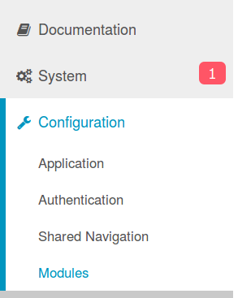
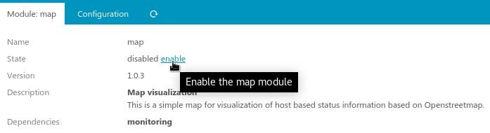

# Installation

## Requirements

* Icinga Web 2 (&gt;= 2.13)
* Icinga PHP Library - IPL
* PHP (&gt;= 8.2)
* The Icinga Web 2 `monitoring` or `icingadb` module

## Installation from .tar.gz

Download the latest version and extract it to a folder named `map`
in one of your Icinga Web 2 module path directories.

You might want to use a script as follows for this task:
```sh
ICINGAWEB_MODULEPATH="/usr/share/icingaweb2/modules"
REPO_URL="https://github.com/nbuchwitz/icingaweb2-module-map"
TARGET_DIR="${ICINGAWEB_MODULEPATH}/map"
MODULE_VERSION="1.1.0"
URL="${REPO_URL}/archive/v${MODULE_VERSION}.tar.gz"
install -d -m 0755 "${TARGET_DIR}"
wget -q -O - "$URL" | tar xfz - -C "${TARGET_DIR}" --strip-components 1
```

## Installation from Git repository

Another convenient method is the installation directly from our Git repository.
Just clone the repository to one of your Icinga Web 2 module path directories.
It will be immediately ready for use:

```sh
ICINGAWEB_MODULEPATH="/usr/share/icingaweb2/modules"
REPO_URL="https://github.com/nbuchwitz/icingaweb2-module-map"
TARGET_DIR="${ICINGAWEB_MODULEPATH}/map"
git clone "${REPO_URL}" "${TARGET_DIR}"
```

You can now directly use our current GIT master or check out a specific version.

## Enable the newly installed module

Enable the Map module either on the CLI by running:

```sh
icingacli module enable map
```

Or go to your Icinga Web 2 frontend, choose `Configuration` -&gt; `Modules`



Choose the Map module and `enable` it:



After enabling the module it might be necessary to refresh your web browser to ensure that newly provided styling is loaded.
