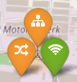
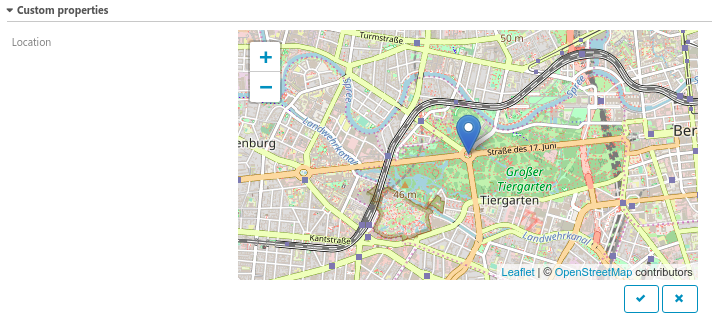

# Add markers to your map

## Add coordinates to a host object in Icinga 2

Add a custom attribute called `geolocation` to any host you want to display on the map. Its value consists of WGS84 coordinates in the following format:

```
vars.geolocation = "<latitude>,<longitude>"
```

In order to highlight the host's coordinate, hold the CTRL key and click on the desired map location. A popup will show you the coordinates of the clicked point in the correct geolocation format, so you could just copy & paste the text.

### Example of a host object

```
object Host "db-in-la" {
  check_command = "hostalive"
  address = "192.168.33.5"
  vars.geolocation = "34.052234,-118.243685"
}
```

Don't forget to reload your icinga2 daemon after adding items to your config.

### Assign different marker icons

Add a custom attribute called `map_icon` to an object already having the custom attribute `geolocation`. Its value must be a name of an icon from the iconfont used in Icinga Web 2 which you can find at /icingaweb2/doc/style/font when you enable the doc module.

```
vars.map_icon = "print"
```

Markers will look like the following example showing the icons sitemap, flapping and wifi.



### Assign coordinates in a more generic way

This is an example on how to add coordinates in a more generic way.

First, we create a reusable map of coordinates for the hosts.

```
/* Some example locations with readable names */
const GeoLocation = {
  "amsterdam" = "52.370216,4.895168",
  "bangkok" = "13.756331,100.501765",
  "beijing" = "39.904200,116.407396",
  "berlin" = "52.524372,13.389856",
  "buenos aires" = "-34.603684,-58.381559",
  "kapstadt" = "-33.924869,18.424055"
  "nuremberg" = "49.425409,11.079655",
  "london" = "51.507351,-0.127758",
  "montreal" = "45.501689,-73.567256",
  "new york" = "40.712784,-74.005941",
  "paris" = "48.856614,2.352222",
  "prague" = "50.075538,14.437800",
  "sydney" = "-33.865143,151.209900",
  "stockholm" = "59.329323,18.068581",
  "tokyo" = "35.689487,139.691706",
  "vienna" = "48.208174,16.373819",
  "zurich" = "47.376887,8.541694",
}

/* Example for a lookup dictionary for short values in host names (you won't need it, but it is more readable) */
const GeoLocationShort = {
  "ams" = "amsterdam"
  "bkk" = "bangkok"
  "pek" = "beijing"
  "ber" = "berlin"
  "eze" = "buenos aires"
  "cpt" = "kapstadt"
  "jfk" = "new york"
  "nue" = "nuremberg"
  "lhr" = "london"
  "yul" = "montreal"
  "cdg" = "paris"
  "prg" = "prague"
  "syd" = "sydney"
  "arn" = "stockholm"
  "hnd" = "tokyo"
  "vie" = "vienna"
  "zrh" = "zurich"
}
```

Second, is a function that will lookup the geo location based on the hostname.
For example, the hosts `ber-web01` and `ber-db01` are located in Berlin.

```
/*
 * Extract host location from the hostname.
 * E.g. if the hostname starts with "ber" we will look up the "ber" geo location.
 */
globals.getHostGeoLocation = function(hostName) {
  var loc = hostName.substr(0,3)
  if (!GeoLocationShort.contains(loc)) {
    log(LogWarning, "globals.getHostGeoLocation", "Cannot find '" + loc + "' in GeoLocationShort")
    return null
  }
  var loc_idx = GeoLocationShort[loc]
  log(LogDebug, "globals.getHostGeoLocation", "Evaluating host " + hostName + " and location " + loc + " (" + loc_idx + ") ")
  if (!GeoLocation.contains(loc_idx)) {
    log(LogWarning, "globals.getHostGeoLocation", "Cannot find '" + loc_idx + "' in GeoLocation")
    return null
  }
  return GeoLocation[loc_idx]
}
```

Basically, the function extracts the location and does a lookup inside the two dictionaries. If nothing is found, a warning is logged.

Now we can use this function and a host template to assign geo locations based on the hostnames.

```
/*
 * Use the function inside a host template (hides the logic)
 */
template Host "geo-host" {
  var loc = getHostGeoLocation(name)
  if (loc) {
    vars.geolocation = loc
  }
}

var num_hosts = 4

while (num_hosts > 0) {
  object Host "ber-" + num_hosts {
    import "geo-host"
    address = "localhost"
    check_command = "dummy"
  }

  object Host "syd-" + num_hosts {
    import "geo-host"
    address = "localhost"
    check_command = "dummy"
  }

  num_hosts = num_hosts - 1
}
```

## Using the Icinga Director

If you're using the [Icinga Director](https://github.com/icinga/icingaweb2-module-director), you can use the [mapDatatype](https://github.com/nbuchwitz/icingaweb2-module-mapDatatype) plugin. This plugin enables you to directly select the coordinates on a map.



## What's next?

After adding the first markers to your map, you want to [explore the map](03-Exploring-the-map.md).
