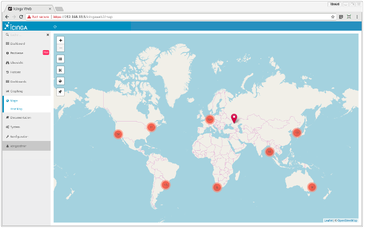
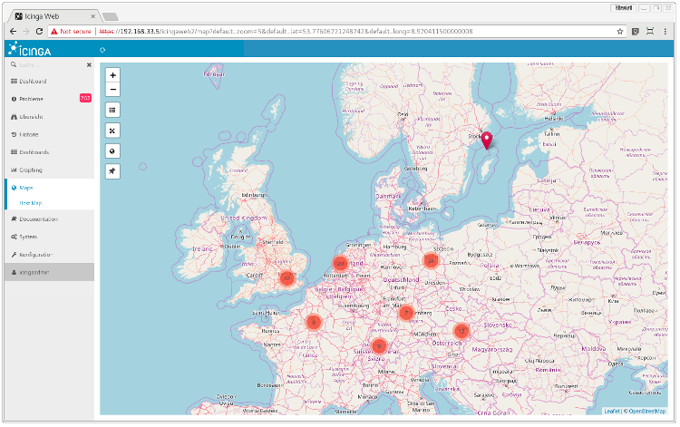
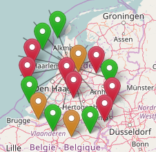
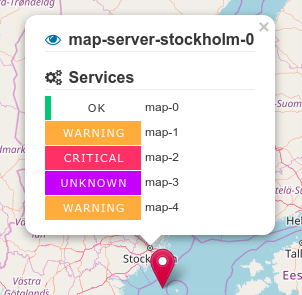
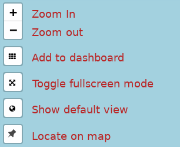

# Exploring the map

The Map module will add a side menu entry in Icinga Web

When you click on it, it will show you a map:

## Basic usage

Every host is represented by a colored marker, which indicates the overall host state.

Markers are grouped into clusters, depending on their location and the zoom level. Every cluster marker has a label with the number of clustered markers.

Note: Holding the `CTRL` key and clicking on the map will open a pop-up with the geolocation format that can be copied.

By clicking on the icon, the cluster expands and the underlying host markers will be visible:

To show more details about a host click on the host marker:

## Control elements

In the upper left corner of the map there are six control elements:

## Dashboard integration

To add a map widget to a dashboard click on the `Add to dashboard` button.

Any filters which are applied to the current view, are also stored in the dashlet.

Note that, the only zoom control elements are visible on dashlets.

## Filtering objects

The Map module allows you to filter objects by using the Icinga Web 2 filter syntax.

### Filter host objects

The usual Icinga Web 2 filter syntax can be used to filter the set of hosts being displayed. Filters have to be appended to the URL (eg. `?host=web*`)

**Filter examples (IDO backend):**

| Filter expression | Description |
| ----------------------------------------------------- | ------------ |
| hostgroup_name=customer1&_host_environment=production | Show all hosts of hostgroup `customer1` of where the custom variable environment is equal to `production` |
| _host_customer=(max-corp\|icinga)                     | Show all hosts where the custom variable `customer` is set to `max-corp` or `icinga` |
| host_in_downtime=0&host_acknowledged=0 | Don't show acknowledged or objects in downtime |
|problems&host_state=1 | Show all hosts in state DOWN `1` (`0` = UP, `1`= DOWN) |

**Filter examples (IcingaDB backend):**

| Filter expression                                         | Description                                                                                               |
|-----------------------------------------------------------|-----------------------------------------------------------------------------------------------------------|
| hostgroup.name=customer1&host.vars.environment=production | Show all hosts of hostgroup `customer1` of where the custom variable environment is equal to `production` |
| host.vars.customer=(max-corp\                             | icinga)                                                                                                   | Show all hosts where the custom variable `customer` is set to `max-corp` or `icinga` |
| host.state.in_downtime=n&host.state.is_acknowledged=n     | Don't show acknowledged or objects in downtime                                                            |
| problems&host.state.soft_state=1                          | Show all hosts in soft state DOWN `1` (`0` = UP, `1`= DOWN)                                               |

For details see: https://icinga.com/blog/icinga-web-filter-syntax/

### Filter objectType

This filter could be used to show only hosts, services or all object types.

**URL:** `/icingaweb2/map?objectType=host`

**Allowed values:**

| Values | Description |
| ------ | ----------- |
| `all` | Show both (hosts & services) on the map |
| `host` | Show only hosts on the map |
| `service` | Show only services on the map |

### Filter problems

If you only want to see hosts or services with states distinct from ``OK``, use this filter.

**URL:** `/icingaweb2/map?problems`
